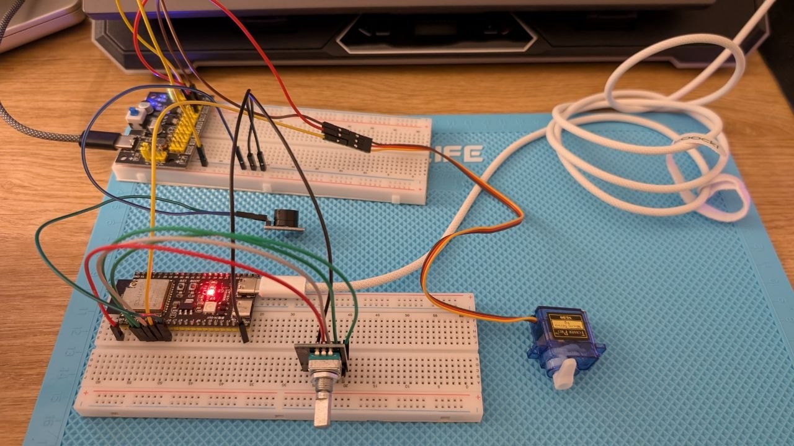

# Embedded Development

This repository exists for education purposes. I use it to learn embedded development and to keep my practice projects in one place.

## Module 3 Mini Project: Safe with a Rotary Encoder



This project is a safe lock. You enter a PIN code with a rotary encoder. The project uses ESP-IDF v6.1 and an ESP32-S3 board.

### Connections

| Part | Pin | GPIO |
|---|---|---|
| Rotary encoder (KY-040) | CLK (signal A) | GPIO5 |
| Rotary encoder (KY-040) | DT (signal B) | GPIO6 |
| Rotary encoder (KY-040) | SW (button) | GPIO7 |
| Servo SG90 (lock) | Signal | GPIO15 |
| Passive buzzer | Signal | GPIO16 |

The program enables the internal pull-up resistors on GPIO5, GPIO6 and GPIO7.

### How to enter the code

The code has 4 digits. The correct code is `3 7 0 5`. To change it, edit `SECRET_CODE` and `CODE_LEN` in `main/main.c`.

1. Turn the shaft one click in a direction. The first digit starts at 0.
2. Turn the shaft in the same direction to increase the digit. After 9, the digit goes back to 0.
3. Turn the shaft one click in the opposite direction. This click confirms the digit. The next digit starts at 0.
4. Do steps 2 and 3 again for all the digits. The click that confirms the last digit starts the code check.
5. Push the encoder button to reset the code and start a new attempt.

You have 3 attempts. A wrong code uses one attempt. A reset uses one attempt if you entered a digit. A reset before the first digit does not use an attempt.

### Results

- **Correct code:** the servo turns from 0° to 90° and a rising tune plays. Push the button to lock the safe again. The lock also resets the attempts to 3.
- **Wrong code:** a short low tune plays. The next attempt starts.
- **No attempts left:** a siren plays 5 times. Then the board stops. You must reboot the board to try again.

### Console log

The program writes each attempt on one console line. It uses `\b` to write each new digit over the old digit:

```
Спроба 1/3. Код: 3 7 0 5
I (20112) SAFE: Код правильний. Сейф відкрито. Натисніть кнопку, щоб закрити
```

Use `idf.py monitor` to see the log. Some IDE consoles do not support `\b`.

### Program structure

The program uses a state machine with 4 states:

| State | Encoder click | Button |
|---|---|---|
| `ST_IDLE` | Starts the first digit | No effect |
| `ST_ENTER` | Increases the digit, or confirms it if the direction changes | Reset, uses an attempt |
| `ST_OPEN` | No effect | Locks the safe |
| `ST_ALARM` | No effect | No effect |

The main loop reads the inputs every 5 ms and sends events (click, opposite click, button) to the state machine.

The pulse counter (PCNT) counts all edges of the CLK and DT signals (X4 mode). Contact bounce on one signal gives +1 and -1, and these values cancel. The program counts a click only after the counter moves by 4 edges (one full click). Thus, bounce cannot cause a false change of direction. The button uses a software debounce of 30 ms.

The servo and the buzzer use the LEDC peripheral. The servo uses a 50 Hz PWM signal (14-bit). A 500 µs pulse gives 0°, and a 2400 µs pulse gives 180°. The buzzer uses a 50 % duty cycle, and the program changes the PWM frequency to play each note.

If one digit needs two clicks, set `ENC_EDGES_PER_DETENT` to 2 in `main/main.c`. Some encoders make a half signal cycle per click.
