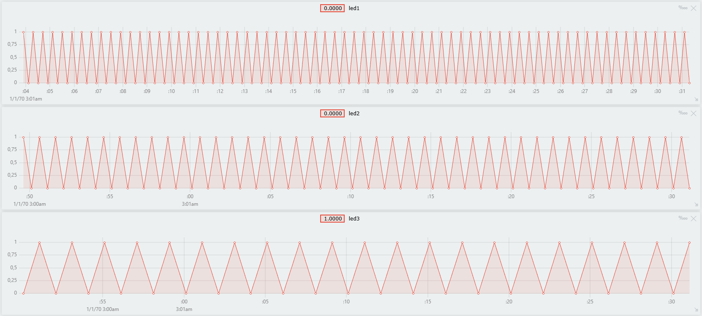

# Module 2.3 Home Task: Superloop and Independent Tasks

This branch holds the Module 2.3 home task. One `loop()` controls three LEDs. Each LED blinks with its own interval, and no LED blocks the others.

## Hardware

- ESP32-S3-DevKitC-1
- Three LEDs. Connect each LED through a 220...330 Ω resistor to GND.

| LED | GPIO | Interval |
|-----|------|----------|
| LED1 | 4 | 200 ms |
| LED2 | 5 | 500 ms |
| LED3 | 6 | 1000 ms |

The interval is the time between two toggles. For example, LED1 is on for 200 ms and off for 200 ms.

## Firmware

All code is in `src/main.cpp`.

### Rules

- The code has no `delay()` calls.
- `loop()` has no `while()` loops that wait for time.
- The code uses `millis()` to measure time.

### Design

- The `Config` structure holds all parameters in `static constexpr` fields. The code has no magic numbers.
- The `Led` class controls one GPIO. It has the `init()` and `set(LedState state)` methods.
- The `BlinkTask` class is one independent task. It keeps its LED, its interval, the last toggle time and the LED state.
- `BlinkTask::update(nowMs)` toggles the LED only when the interval is over. Otherwise it returns immediately.
- `loop()` reads `millis()` one time and calls `update()` for each task. One `loop()` iteration takes a few microseconds.

`update()` adds the interval to the last toggle time. It does not set the last toggle time to `nowMs`. Thus a late `loop()` iteration does not shift the blink period. The unsigned subtraction `nowMs - lastToggleMs_` stays correct after the `millis()` overflow.

To add a fourth LED, add one line to the `tasks[]` array.

### Serial Output

Each task prints its LED state in Teleplot format with an explicit timestamp:

```
>led1:<timestamp, ms>:<0 or 1>
```

At each toggle, the task prints the old state and the new state with the same timestamp. Teleplot keeps one point for each timestamp and draws straight lines between the points. Thus each chart shows a triangle wave. Each point is one toggle.

#### Result



| LED | Interval | Time between two peaks on the chart |
|-----|----------|-------------------------------------|
| LED1 | 200 ms | 400 ms (about 2.5 peaks per second) |
| LED2 | 500 ms | 1 s |
| LED3 | 1000 ms | 2 s |

The time between two peaks is two intervals: one interval on and one interval off. The three LEDs keep their own periods in the same `loop()`. On all three charts, the peaks stay at equal distances.

## Build and Run

```
pio run -t upload
pio device monitor
```
