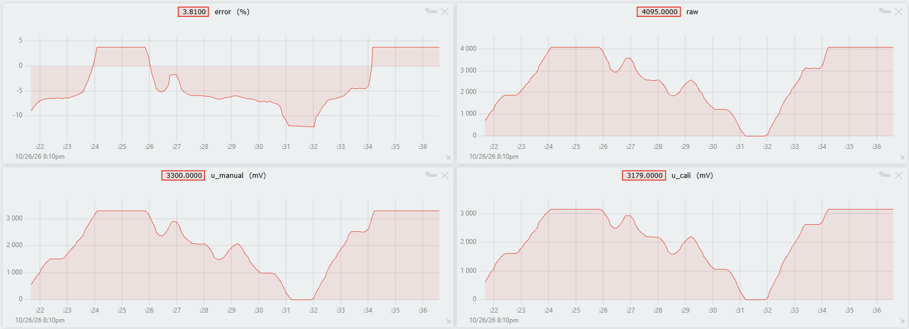

# Embedded Development

This repository exists for education purposes. I use it to learn embedded development and to keep my practice projects in one place.

## Task 3.2: ADC Data Calibration

This task reads a potentiometer with the ADC and compares two ways to get the voltage. The project uses ESP-IDF v6.1 and an ESP32-S3 board.

