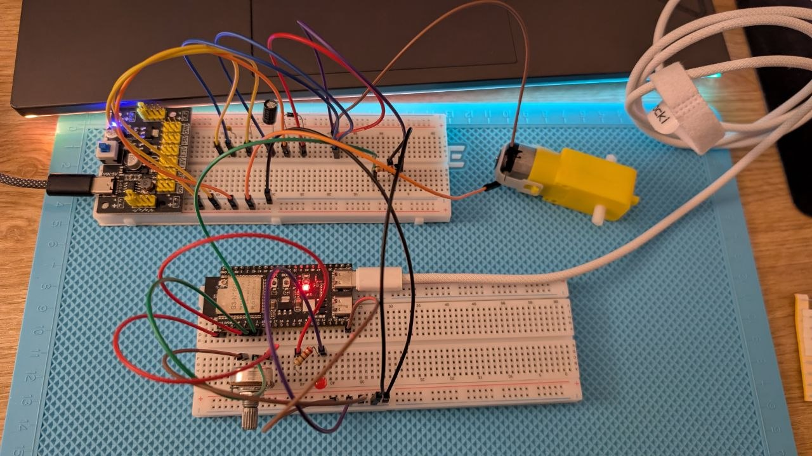

# Embedded Development

This repository exists for education purposes. I use it to learn embedded development and to keep my practice projects in one place.

## Task 3.3: Pulse Width Modulation (PWM)

This task controls the brightness of an LED and the speed of a DC motor with one potentiometer. The project uses ESP-IDF v6.1 and an ESP32-S3 board.

### Circuit

- The potentiometer is 10 kΩ. Its outer pins connect to 3.3 V and GND. Its middle pin connects to GPIO6 (ADC1, channel 5).
- The LED connects to GPIO5 through a 330 Ω resistor.
- The motor connects through a 2N2222A transistor. GPIO7 connects to the transistor base through a 220 Ω resistor. A 10 kΩ resistor connects the base to GND and keeps the motor off at boot.
- The motor gets power from a separate 5 V supply. The supply GND connects to the ESP32 GND.
- A flyback diode (stripe to +5 V) and a 100 nF capacitor connect across the motor terminals.

### Program

The program reads the potentiometer every 20 ms. It reads the ADC 16 times and calculates the average value (0…4095). Then it calculates two duty values from this value:

1. LED: the duty changes linearly from 0 % to 100 %.
2. Motor: the duty starts at 15 % and goes to 100 %. A DC motor does not start below approximately 35 % duty.

At the bottom of the knob (an ADC value below 100), both duty values are 0 %. The program updates a channel only if its duty changes by more than 4 steps. This stops PWM jitter from ADC noise. Every 0.5 s, the program writes the potentiometer value and the two duty values to the console.

### Independent LED and motor

The LED and the motor do not have an effect on each other:

| Device | Pin | LEDC timer | LEDC channel | Frequency |
|---|---|---|---|---|
| LED | GPIO5 | Timer 0 | Channel 0 | 5 kHz |
| Motor | GPIO7 | Timer 1 | Channel 1 | 20 kHz |

Each device has its own timer and channel, so each device has its own frequency and duty. A change to one channel does not change the other channel. The LED uses 5 kHz, so you see no flicker. The motor uses 20 kHz, so you hear no noise from the motor. The separate motor supply, the diode and the capacitor keep the motor noise away from the ADC and the LED.
