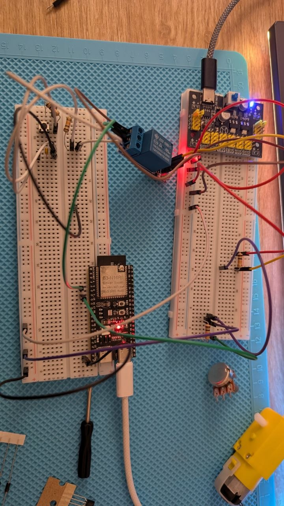
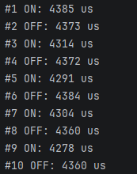
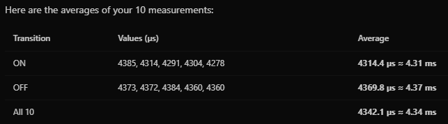
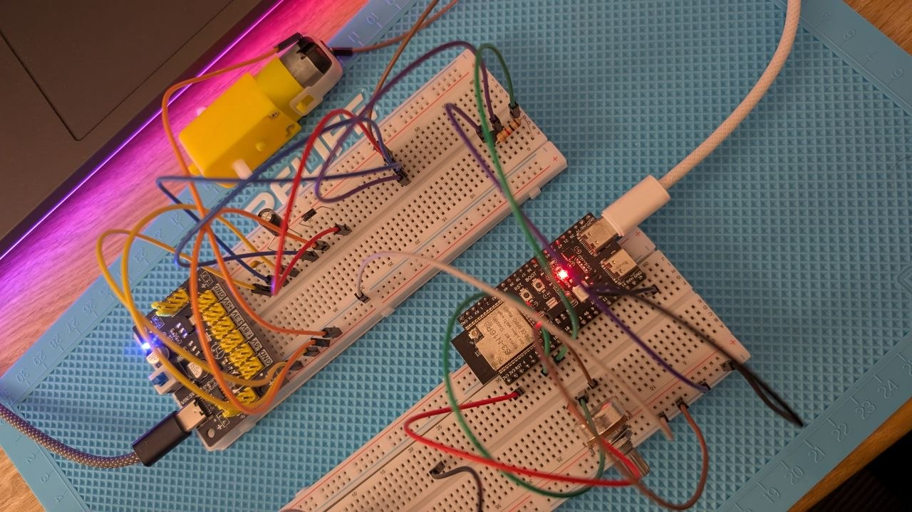

# Embedded Development

This repository exists for education purposes. I use it to learn embedded development and to keep my practice projects in one place.

## Task 2.2 Schema

The photo shows the circuit for task 2.2.

### Results

The Serial Monitor shows 10 measurements. The ON and OFF lines alternate.

The table shows the average switching time for ON, for OFF and for all 10 measurements.

## Task 2.2 (Optional) Schema

The photo shows the circuit for the optional part of task 2.2.

