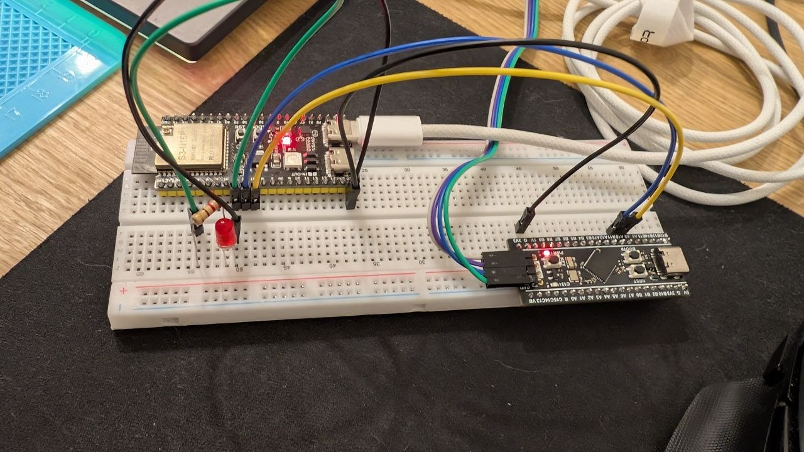

# Embedded Development

This repository exists for education purposes. I use it to learn embedded development and to keep my practice projects in one place.

## Task 4.1: UART Communication Between Microcontrollers

This task connects an ESP32-S3 board and an STM32F411 board (Black Pill) with UART. The task has two requirements:

1. A press of the button on the ESP32 changes the state of the LED on the STM32. We did this part during the lesson.
2. A press of the button on the STM32 changes the state of the LED on the ESP32.

The project uses two folders:

- The `esp` folder contains the ESP32-S3 project. It uses ESP-IDF v6.1.
- The `stm` folder contains the STM32 project. It uses STM32CubeMX and the HAL library.

### Wiring

| ESP32-S3 | STM32F411 |
|---|---|
| GPIO17 (UART1 TX) | PA10 (USART1 RX) |
| GPIO18 (UART1 RX) | PA9 (USART1 TX) |
| GND | GND |

An external LED connects to GPIO16 on the ESP32-S3 through a 330 Ω resistor. The STM32 uses its onboard LED on PC13.

The UART settings are 115200 baud, 8 data bits, no parity, and 1 stop bit.

### Commands

The boards send one byte for each command:

- `L` turns on the LED.
- `O` turns off the LED.

### ESP32-S3

The program does not use FreeRTOS tasks or GPIO interrupts. The `app_main` function runs one loop:

1. It waits for one byte from UART1 for a maximum of 10 ms.
2. If it gets `L` or `O`, it sets the LED on GPIO16.
3. It reads the BOOT button (GPIO0).
4. If the button is pressed for 30 ms, it toggles the LED state of the STM32 and sends `L` or `O`.

At start, the program sends `O`. Thus, the STM32 LED starts in the off state.

### STM32

USART1 receives one byte with an interrupt. The receive callback sets the LED on PC13 and starts the next reception. The error callback also starts the reception again.

The LED on PC13 is active low. Thus, the program writes a low level to turn on the LED.

The main loop reads the KEY button (PA0). If the button is pressed for 30 ms, the program toggles the LED state of the ESP32-S3 and sends `L` or `O`. At start, the program sends `O`.
