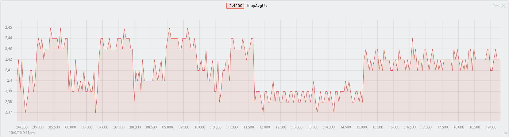

# Module 2.1 Home Task: Embedded C++ on ESP32-S3

This branch holds the Module 2.1 home task. The task rewrites the classic Arduino blink in Embedded C++.

## Hardware

- ESP32-S3-DevKitC-1
- LED on GPIO 4 through a 220...330 Ω resistor to GND
- Push button between GPIO 6 and GND. The firmware enables the internal pull-up resistor.

To test without a button, set `Config::BUTTON_PIN` to `0`. GPIO 0 is the on-board BOOT button.

## Firmware

All code is in `src/main.cpp`.

### 1. Blink in Embedded C++

The classic blink turns the LED on for 1 s and off for 1 s with `delay()`. This version does the same without `delay()`:

- `enum class LedState { Off, On }` holds the LED state.
- The `Led` class has the `init()` and `set(LedState state)` methods.
- The superloop compares `millis()` with the time of the last toggle. The unsigned subtraction stays correct after the `millis()` overflow.
- The loop state is in `static` local variables. The only global variables are the `constexpr Led` object and the ISR flag.

### 2. Parameters in `static constexpr`

The `Config` structure holds all parameters, so the code has no magic numbers.

| Parameter | Value | Purpose |
|-----------|-------|---------|
| `LED_PIN` | 4 | LED GPIO |
| `BUTTON_PIN` | 6 | Button GPIO |
| `BLINK_INTERVAL_MS` | 1000 | LED on time and off time |
| `DEBOUNCE_MS` | 200 | Minimum time between two presses |
| `SERIAL_BAUD` | 115200 | Serial port speed |
| `PROFILE_ITERATIONS` | 1000 | Iterations per time report |

### 3. Superloop Time (Optional)

The firmware measures each `loop()` iteration with `micros()`. Every 1000 iterations, it prints the average time in Teleplot format:

```
>loopAvgUs:<average, us>
```

#### Result

The Teleplot chart shows the average loop time during three LED modes. The button changed the mode two times:



| Period | Mode | Average loop time |
|--------|------|-------------------|
| 1 (about :04.5 to :11.8) | Blink | 2.37...2.45 µs |
| 2 (about :11.8 to :15.1) | AlwaysOn | 2.37...2.40 µs |
| 3 (about :15.1 to :19.2) | AlwaysOff | 2.41...2.44 µs |

One `loop()` iteration takes about 2.4 µs. The time depends on the LED state. In the Blink mode, the value changes between two levels every 1 s. The lower level (about 2.39 µs) matches the AlwaysOn mode. The higher level (about 2.43 µs) matches the AlwaysOff mode.

### 4. Button with an Interrupt (Optional)

- `attachInterrupt()` calls the `onButtonPress()` ISR on the falling edge.
- The ISR only sets the `volatile bool buttonPressed` flag. It has no `Serial.print()` calls and no delays.
- `loop()` does the debounce. It accepts a press only 200 ms or more after the last press, and only while the button is still down.
- Each press changes the LED mode: Blink → AlwaysOn → AlwaysOff → Blink.

## Build and Run

```
pio run -t upload
pio device monitor
```
