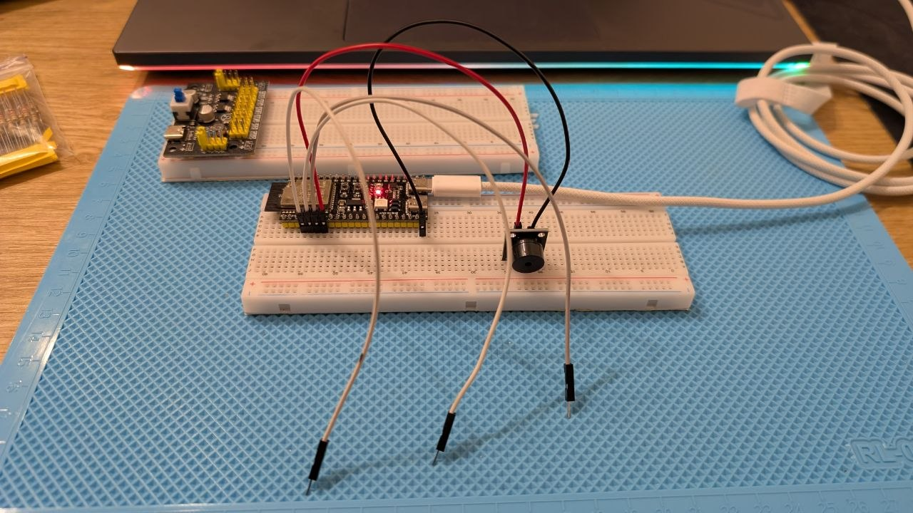

# Embedded Development

This repository exists for education purposes. I use it to learn embedded development and to keep my practice projects in one place.

## Task 3.4: Buzzer Synthesizer with Touch Keys

This task makes a synthesizer with 3 notes. You use it to play a simple melody on a buzzer. The project uses ESP-IDF v6.1 and an ESP32-S3 board.

The buzzer is a passive buzzer on GPIO7. The 3 touch keys are jumper wires on GPIO4, GPIO5 and GPIO6. You touch the free end of a wire to play a note. These pins use the built-in capacitive touch sensor (channels TOUCH4, TOUCH5 and TOUCH6).

| Key | Pin | Note |
|-----|-------|---------------|
| 1 | GPIO4 | C4 (262 Hz) |
| 2 | GPIO5 | D4 (294 Hz) |
| 3 | GPIO6 | E4 (330 Hz) |

The program works in this sequence:

1. The touch sensor scans the 3 pads continuously in the background.
2. The sensor keeps a benchmark (the value without a touch) for each pad.
3. When the value of a pad increases by more than 4000 above its benchmark, the sensor starts the `on_active` interrupt. The interrupt saves the number of the key.
4. When the value decreases again, the sensor starts the `on_inactive` interrupt. The interrupt clears the key.
5. Every 10 ms, the main loop reads the key. If the key changes, the program sets the note frequency on the buzzer with a PWM signal (LEDC, 10-bit, 50% duty). If no key is touched, the program stops the sound.

The synthesizer plays only one note at a time. A new touch replaces the note that plays.

The sensor measures the benchmark at startup. Do not touch the pads when the board starts.

You can play these melodies with the 3 keys:

- Baby Shark: `C D E | C D E | C D E`
- We Will Rock You: `C C D | C C D | C C D E`
