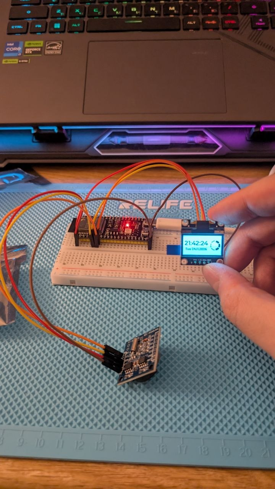

# Embedded Development

This repository exists for education purposes. I use it to learn embedded development and to keep my practice projects in one place.

## Task 4.3: I²C Clock

This task reads the time from a DS1307 real-time clock and shows the time and the date on an SSD1306 OLED display (128x64). The project uses ESP-IDF v6.1, the `i2c_master` driver, the `esp_lcd` SSD1306 driver, LVGL 8.4 with `esp_lvgl_port`, and an ESP32-S3 board.

### Wiring

The two modules use the same I²C bus.

| Module pin | ESP32-S3 |
|---|---|
| SSD1306 GND, DS1307 GND | GND |
| SSD1306 VCC, DS1307 VCC | 3V3 |
| SSD1306 SDA, DS1307 SDA | GPIO6 |
| SSD1306 SCL, DS1307 SCL | GPIO7 |

| Device | Address |
|---|---|
| SSD1306 | `0x3C` |
| DS1307 | `0x68` |

The bus speed is 100 kHz, because the DS1307 accepts a maximum of 100 kHz. The program also turns on the internal pull-up resistors on SDA and SCL.

The DS1307 datasheet gives a supply voltage from 4.5 V to 5.5 V. If the VCC voltage is less than 1.25 × VBAT, the DS1307 stops I²C access. Thus, with a 3V3 supply, do not install a 3 V backup battery.

### Display

The screen shows one group in the horizontal center:

- The time in the `HH:MM:SS` format (`15:33:59`) in the Montserrat 20 font.
- The date in the `EEE DD.MM.YYYY` format (`Sat 14.02.2026`) in the Montserrat 10 font, below the time.
- A ring of 6 segments to the right of the text. Each segment is 10 seconds. Segment `i` comes on at second `i × 10` and stays on until the end of the minute. At second 0, the ring starts again with one segment.

The time and the date have the same vertical axis. The text group is in the vertical center of the screen.

### Photo

The photo shows the ESP32-S3 board, the SSD1306 display and the DS1307 module on one I²C bus.

### Program structure

| Function | Description |
|---|---|
| `i2c_bus_init()` | Starts the I²C master bus on GPIO6 and GPIO7. |
| `i2c_scan()` | Writes the address of each device on the bus to the console. |
| `rtc_init()` | Adds the DS1307 to the bus. If the clock is stopped, the function sets the time of the build. |
| `rtc_read_time()` | Reads registers `0x00`–`0x06` and changes the BCD values to a `struct tm`. |
| `rtc_write_time()` | Changes a `struct tm` to BCD values and writes registers `0x00`–`0x06`. |
| `display_init()` | Starts the SSD1306 panel and LVGL, and makes the labels and the ring. |
| `display_update()` | Writes the time and the date to the labels and turns on the ring segments. |

### DS1307 registers

| Register | Contents | Mask |
|---|---|---|
| `0x00` | Seconds, bit 7 = CH (clock halt) | `0x7F` |
| `0x01` | Minutes | `0x7F` |
| `0x02` | Hours (24-hour mode) | `0x3F` |
| `0x03` | Day of the week | not used |
| `0x04` | Day of the month | `0x3F` |
| `0x05` | Month | `0x1F` |
| `0x06` | Year (00–99) | `0xFF` |

If the CH bit is 1, the clock is stopped. Then `rtc_read_time()` returns `ESP_ERR_INVALID_STATE`, and `rtc_init()` writes the date and the time of the build (`__DATE__`, `__TIME__`).

The program does not use register `0x03`. It calculates the day of the week from the date with `mktime()`.

### Screen update

The main loop reads the DS1307 every 200 ms. When the seconds value changes, the program updates the screen. Thus, the screen updates one time each second.
